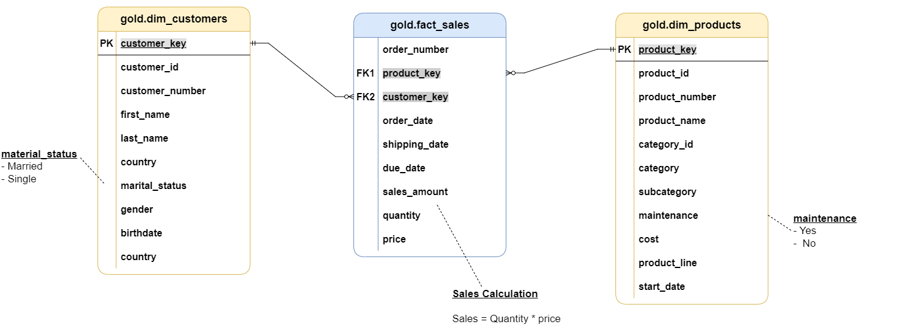

# SQL Data Warehouse Project

A modern data warehouse built on **Microsoft SQL Server**, covering the full path from raw source files to analytics-ready data: ETL, data modelling (star schema) and SQL-based analytics and reporting.

The project follows the **Medallion Architecture** (Bronze → Silver → Gold) and integrates two source systems (CRM and ERP) into a single, clean, business-oriented model.

>  **Credits:** this project is based on the *SQL Data Warehouse* course by **[Baraa Khan (Data With Baraa)](https://www.youtube.com/@DataWithBaraa)**. The architecture, the datasets and the overall project design come from his work. I implemented the scripts hands-on while following the course and added my own documentation. See [Acknowledgements](#acknowledgements).

---

## Project Goals

- **Consolidate** data from two heterogeneous sources (CRM and ERP) into one warehouse.
- **Clean and standardise** the data: deduplication, type casting, normalisation of codes, handling of nulls and invalid dates.
- **Model** the data as a star schema optimised for analytical queries.
- **Analyse** sales, customers and products with SQL, and expose the results as reusable reporting views.

---

## Architecture


| Layer | Purpose | Object type | Transformations |
|-------|---------|-------------|-----------------|
| **Bronze** | Raw data, loaded as-is from the source CSV files | Tables | None (full load: truncate and insert) |
| **Silver** | Cleaned and standardised data | Tables | Cleansing, standardisation, deduplication, derived columns |
| **Gold** | Business-ready data for reporting and analytics | Views | Data integration, business logic, star schema |

More diagrams are available in the [`documents/`](documents) folder: [data flow](documents/data_flow.png), [data integration](documents/data_integration.png), [data model](documents/data_model.png) and [data layers](documents/data_layers.pdf).

---

## Data Sources

Data comes from two source systems, provided as CSV files in [`datasets/`](datasets):

| System | File | Content | Rows |
|--------|------|---------|------|
| CRM | `cust_info.csv` | Customer master data | ~18.5k |
| CRM | `prd_info.csv` | Product information and history | ~400 |
| CRM | `sales_details.csv` | Sales transactions | ~60k |
| ERP | `CUST_AZ12.csv` | Additional customer data (birthdate, gender) | ~18.5k |
| ERP | `LOC_A101.csv` | Customer country | ~18.5k |
| ERP | `PX_CAT_G1V2.csv` | Product categories and subcategories | 35 |

---

## Data Model (Gold Layer)

The Gold layer is a **star schema** with one fact table and two dimensions:



- **`gold.fact_sales`**: sales transactions (order, ship and due dates, sales amount, quantity, price).
- **`gold.dim_customers`**: customers enriched with demographic and geographic data (CRM + ERP).
- **`gold.dim_products`**: products with category, subcategory and product line; only current (non-historical) products are kept.

Column-level documentation is available in the [Data Catalog](documents/data_catalog.md).

---

## ETL Highlights

- **Bronze load** via `BULK INSERT`, wrapped in a stored procedure with logging of load durations and `TRY/CATCH` error handling.
- **Deduplication** of customers by keeping the most recent record per `cst_id` (`ROW_NUMBER()`).
- **Standardisation** of coded values (e.g. `M`/`S` → `Married`/`Single`, `R`/`M`/`T` → `Road`/`Mountain`/`Touring`).
- **Slowly changing product history**: product end dates are derived with `LEAD()` over the start dates.
- **Integration** of CRM and ERP data through key alignment (e.g. rebuilding the product category ID from the product key).
- **Surrogate keys** generated in the Gold layer with `ROW_NUMBER()`.

---

## Data Quality Checks

SQL tests in [`tests/`](tests) validate each layer:

- [`quality_checks_silver.sql`](tests/quality_checks_silver.sql): duplicates and nulls in primary keys, unwanted spaces, standardisation consistency, invalid date ranges, sales/quantity/price consistency.
- [`quality_check_gold.sql`](tests/quality_check_gold.sql): uniqueness of surrogate keys and referential integrity between the fact table and the dimensions.

---

## Analytics & Reporting

The scripts in [`scripts/data_analytics`](scripts/data_analytics) run exploratory and advanced analyses on the Gold layer:

| Script | Topic |
|--------|-------|
| `01`–`04` | Database, dimensions, date range and measures exploration |
| `05` | Magnitude analysis (e.g. sales by country, category, gender) |
| `06` | Ranking analysis (top/bottom products and customers) |
| `07` | Change over time (monthly and yearly trends) |
| `08` | Cumulative analysis (running totals, moving averages) |
| `09` | Performance analysis (year-over-year, vs. average) |
| `10` | Data segmentation (customer and product clusters) |
| `11` | Part-to-whole analysis (contribution by category) |
| `12` | **Customer report** view: segments (VIP / Regular / New), age groups, recency, average order value, average monthly spend |
| `13` | **Product report** view: product-level performance and KPIs |

### Report Views

The two reporting views consolidate the analyses into ready-to-use datasets (e.g. for a BI tool such as Power BI).

**`gold.report_customers`** (one row per customer)

- Columns: customer key and number, name, age, age group, customer segment, last order date, recency (months), total orders, total sales, total quantity, total products, lifespan (months), average order value, average monthly spend.
- Customer segments: **VIP** (at least 12 months of history and total sales above 5,000), **Regular** (at least 12 months of history and total sales up to 5,000), **New** (less than 12 months of history).
- Age groups: Under 20, 20-29, 30-39, 40-49, 50 and above.

**`gold.report_products`** (one row per product)

- Columns: product key and name, category, subcategory, cost, last sale date, recency (months), product segment, lifespan (months), total orders, total sales, total quantity, total customers, average selling price, average order revenue, average monthly revenue.
- Product segments: **High-Performer** (total sales above 50,000), **Mid-Range** (10,000 to 50,000), **Low-Performer** (below 10,000).


`report_customers`

| customer_key | customer_name | age | age_group | customer_segment | last_order_date | total_orders | total_sales | total_quantity |
|---|---|---|---|---|---|---|---|---|
| 1 | Jon Yang | 54 | 50 and above | VIP | 2013-05-03 | 3 | 8,249 | 8 |
| 2 | Eugene Huang | 49 | 40-49 | VIP | 2013-12-10 | 3 | 6,384 | 11 |
| 13 | Lauren Walker | 46 | 40-49 | New | 2013-10-15 | 2 | 81 | 5 |

`report_products`

| product_key | product_name | category | subcategory | cost | last_sale_date | product_segment | lifespan | total_orders | total_sales |
|---|---|---|---|---|---|---|---|---|---|
| 3 | Mountain-100 Black- 38 | Bikes | Mountain Bikes | 1,898 | 2011-12-27 | High-Performer | 11 | 49 | 165,375 |
| 16 | Road-150 Red- 44 | Bikes | Road Bikes | 2,171 | 2011-12-28 | High-Performer | 12 | 281 | 1,005,418 |
| 36 | Road-650 Black- 44 | Bikes | Road Bikes | 487 | 2012-12-26 | Mid-Range | 23 | 63 | 47,565 |

---

## Repository Structure

```
SQL-data-warehouse-project/
│
├── datasets/                  # Source CSV files
│   ├── source_crm/
│   └── source_erp/
│
├── documents/                 # Diagrams and data catalog
│
├── scripts/
│   ├── data_warehouse/
│   │   ├── init_database.sql  # Creates the database and the bronze/silver/gold schemas
│   │   ├── bronze/            # DDL and load procedure (source -> bronze)
│   │   ├── silver/            # DDL and load procedure (bronze -> silver)
│   │   └── gold/              # Star schema views
│   └── data_analytics/        # Exploratory analyses and reports
│
├── tests/                     # Data quality checks
└── README.md
```

---

## How to Run

### Prerequisites

- Microsoft SQL Server (Express or Developer edition is enough)
- SQL Server Management Studio (SSMS) or Azure Data Studio

### Steps

1. **Clone the repository**
   ```bash
   git clone https://github.com/Francesco1512/SQL-data-warehouse-project.git
   ```
2. **Initialise the database** by running `scripts/data_warehouse/init_database.sql`.
   > ⚠️ This script drops and recreates the `DataWarehouse` database if it already exists.
3. **Create the Bronze tables** (`bronze/ddl_bronze.sql`) and **load them**.
   Before running the procedure, update the CSV file paths inside `bronze/proc_load_bronze.sql` so they point to the `datasets/` folder on your machine, then:
   ```sql
   EXEC bronze.load_bronze;
   ```
4. **Create the Silver tables** (`silver/ddl_silver.sql`) and **load them**:
   ```sql
   EXEC silver.load_silver;
   ```
5. **Create the Gold views** by running `gold/DDL_gold.sql`.
6. **Run the quality checks** in `tests/` (queries should return no rows, as stated in each script).
7. **Explore the data** with the scripts in `scripts/data_analytics`.

---

## Tech Stack

- **Microsoft SQL Server** (T-SQL)
- **Stored procedures**, **views**, **window functions**, **CTEs**
- **SSMS** for development
- **Draw.io**-style diagrams for architecture and data model 

---

## Skills Demonstrated

Data warehousing · ETL design · Medallion architecture · Dimensional modelling (star schema) · Data cleansing and quality testing · Advanced SQL analytics (window functions, CTEs, segmentation, KPI reporting)

---

## Acknowledgements

Full credit for the project concept, the architecture, the datasets and the course material goes to **[Baraa Khan (Data With Baraa)](https://www.youtube.com/@DataWithBaraa)**, whose *SQL Data Warehouse* course this repository is based on. I followed the course to build the project and used it to practise data warehousing, ETL and SQL analytics.

---

## Author

**Francesco Pascullo**
GitHub: [@Francesco1512](https://github.com/Francesco1512)
